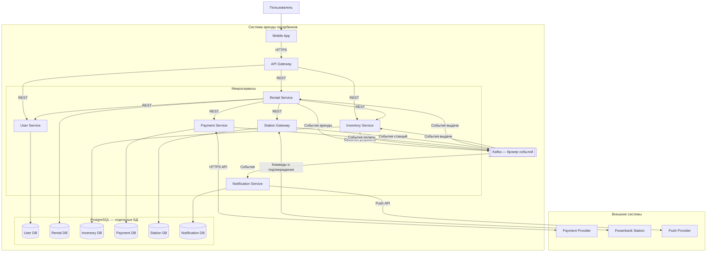

# C4 Container — система аренды пауэрбанков

## 1. Назначение диаграммы

Диаграмма C4 уровня Container отражает техническую архитектуру системы аренды пауэрбанков.

Она показывает мобильное приложение, API Gateway, шесть микросервисов, принадлежащие им базы данных, брокер сообщений и внешние системы.

Каждый микросервис отвечает за самостоятельную функциональную область и управляет собственной базой данных.

## 2. Основные компоненты системы

### Mobile App

Мобильное приложение, через которое пользователь выбирает станцию, создаёт аренду, просматривает её состояние и историю операций.

### API Gateway

Единая точка входа для запросов мобильного приложения. Направляет запросы к соответствующим микросервисам.

### User Service

Управление пользователями, регистрацией и авторизацией.

### Rental Service

Управление жизненным циклом аренды и координация основного бизнес-процесса.

### Inventory Service

Учёт станций и пауэрбанков, резервирование и управление доступностью оборудования.

### Payment Service

Управление денежными операциями и взаимодействие с платёжным провайдером.

### Station Gateway

Передача команд физическим станциям и получение подтверждений выполнения операций.

### Notification Service

Обработка событий и отправка уведомлений пользователям.

### PostgreSQL

Реляционная система управления базами данных. Каждый микросервис использует собственную изолированную базу данных.

### Kafka

Брокер событий для асинхронного взаимодействия сервисов. Используется для передачи событий об аренде, платежах и состоянии оборудования.

## 3. Внешние системы

- **Payment Provider** — внешний платёжный провайдер для блокировки депозитов, списаний и возвратов.
- **Powerbank Station** — физическая станция выдачи и приёма пауэрбанков.
- **Push Provider** — внешний сервис доставки уведомлений.

## 4. Взаимодействие компонентов

Синхронное взаимодействие между мобильным приложением, API Gateway и микросервисами осуществляется через HTTPS/REST.

Для асинхронной передачи событий используется Kafka.

Каждый сервис имеет доступ только к собственной базе данных. Другие сервисы получают необходимую информацию через API или события.

## 5. Диаграмма C4 Container

