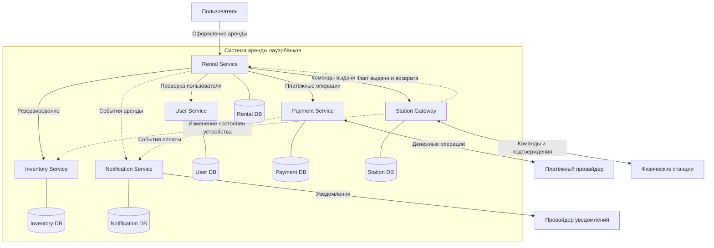

# Карта контекстов системы аренды пауэрбанков

## 1. Назначение системы

Разрабатываемая система предназначена для автоматизации процесса аренды портативных зарядных устройств (пауэрбанков) через специальные станции.

Пользователь с помощью мобильного приложения выбирает станцию, резервирует доступный пауэрбанк, вносит депозит и получает устройство. После возврата пауэрбанка система рассчитывает стоимость аренды и выполняет окончательный расчёт.

Система построена на микросервисной архитектуре. Отдельные сервисы отвечают за управление пользователями, арендами, устройствами, платежами, взаимодействие с физическими станциями и отправку уведомлений.

Основные требования к надёжности системы:

- один пауэрбанк не может быть одновременно выдан двум пользователям;
- одна платёжная операция не должна выполняться дважды при повторном запросе;
- факт выдачи и возврата пауэрбанка не должен теряться;
- при сбоях система должна обеспечивать восстановление или компенсацию незавершённых операций.

## 2. Выделение микросервисов

### 2.1. User Service — управление пользователями

Сервис отвечает за регистрацию, авторизацию и управление учётными записями пользователей. Хранит идентификаторы пользователей, контактные данные и сведения о профилях. Выделяется в отдельный контекст, поскольку управление пользователями является самостоятельной предметной областью и не должно зависеть от работы аренды, платежей или физических станций.

**Владелец данных:** User DB.

### 2.2. Rental Service — управление арендой

Сервис отвечает за создание аренды, изменение её состояния и завершение. Координирует резервирование устройства, авторизацию депозита, выдачу пауэрбанка и окончательный расчёт. Основные состояния: CREATED, RESERVED, ACTIVE, COMPLETED, CANCELLED. Выделяется отдельно, поскольку реализует центральную бизнес-логику аренды и координирует работу других сервисов, не управляя напрямую их данными.

**Владелец данных:** Rental DB.

### 2.3. Inventory Service — учёт оборудования

Сервис управляет каталогом станций и пауэрбанков, хранит сведения об их доступности и резервировании. Контролирует переходы устройств между состояниями AVAILABLE, RESERVED, RENTED, UNAVAILABLE. Обеспечивает атомарное резервирование, чтобы одно устройство не было одновременно закреплено за несколькими арендами. Выделяется отдельно, поскольку учёт оборудования требует самостоятельной модели данных и механизмов контроля конкурентного доступа.

**Владелец данных:** Inventory DB.

### 2.4. Payment Service — управление платежами

Сервис отвечает за авторизацию и блокировку депозита, окончательное списание стоимости аренды, отмену блокировки и возвраты. Взаимодействует с внешним платёжным провайдером и хранит историю платёжных операций и их статусы. Обеспечивает идемпотентность операций, чтобы повторные запросы не приводили к повторным списаниям. Выделяется отдельно, поскольку денежные операции требуют независимого учёта, контроля безопасности и специальных механизмов восстановления после сбоев.

**Владелец данных:** Payment DB.

### 2.5. Station Gateway — взаимодействие с физическими станциями

Сервис отвечает за передачу команд физическим станциям, получение подтверждений выдачи и возврата устройств, а также обработку ситуаций временной потери связи. Хранит идентификаторы команд, их статусы и результаты выполнения. Выделяется отдельно, поскольку взаимодействие с оборудованием требует специализированных протоколов и механизмов повторной обработки сообщений.

**Владелец данных:** Station DB.

### 2.6. Notification Service — уведомления

Сервис отвечает за отправку уведомлений о начале и завершении аренды, оплате и возникших проблемах. Получает события от других микросервисов и передаёт уведомления через внешнего провайдера. Выделяется отдельно, поскольку отправка сообщений является вспомогательным процессом и её временная недоступность не должна останавливать аренду.

**Владелец данных:** Notification DB, в которой хранятся статусы доставки и повторных отправок.

## 3. Владение данными и взаимодействие

Каждый микросервис управляет собственной базой данных и предоставляет доступ к необходимым операциям через программные интерфейсы или события. Прямое обращение одного сервиса к базе данных другого не допускается.

Rental Service координирует основной процесс аренды, обращаясь к User Service для проверки пользователя, Inventory Service для резервирования устройства, Payment Service для проведения денежных операций и Station Gateway для выдачи пауэрбанка.

Notification Service получает события о состоянии аренды и платежей и отправляет уведомления пользователям.

Физические станции, платёжный провайдер и провайдер уведомлений рассматриваются как внешние системы.

## 4. Диаграмма контекстов

Диаграмма показывает границы ответственности шести микросервисов, их взаимодействие и связи с внешними системами.
