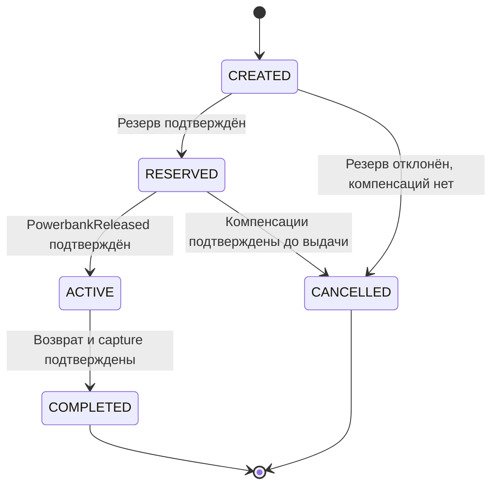
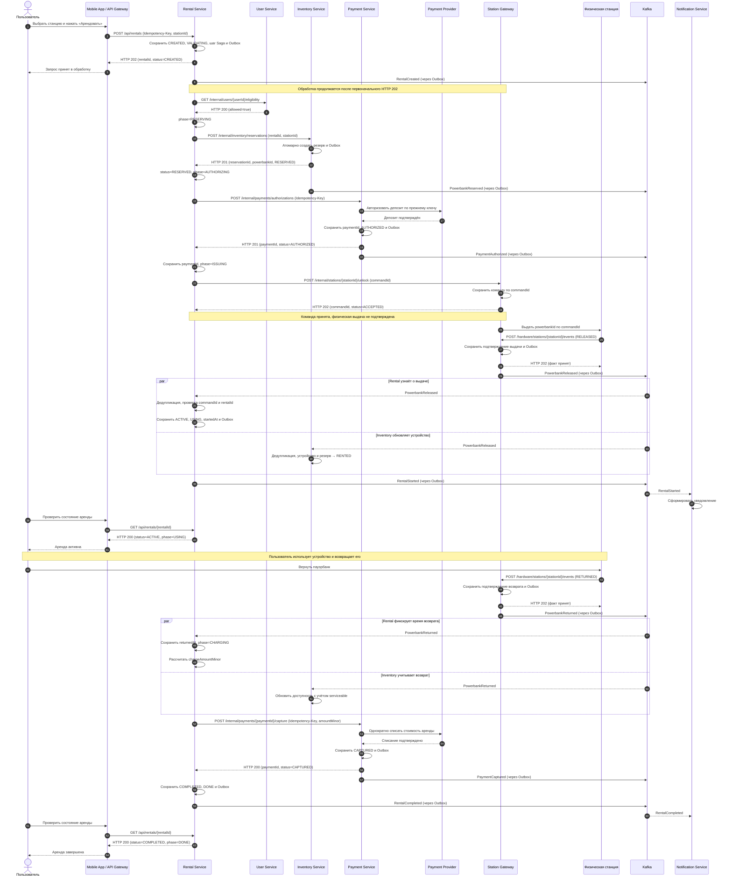
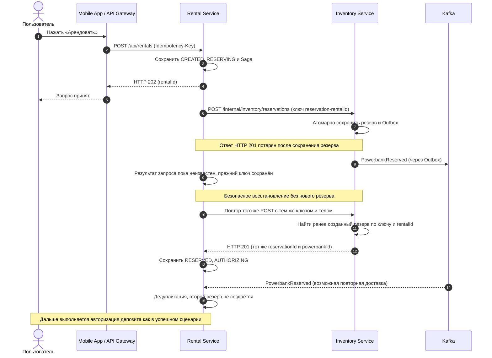
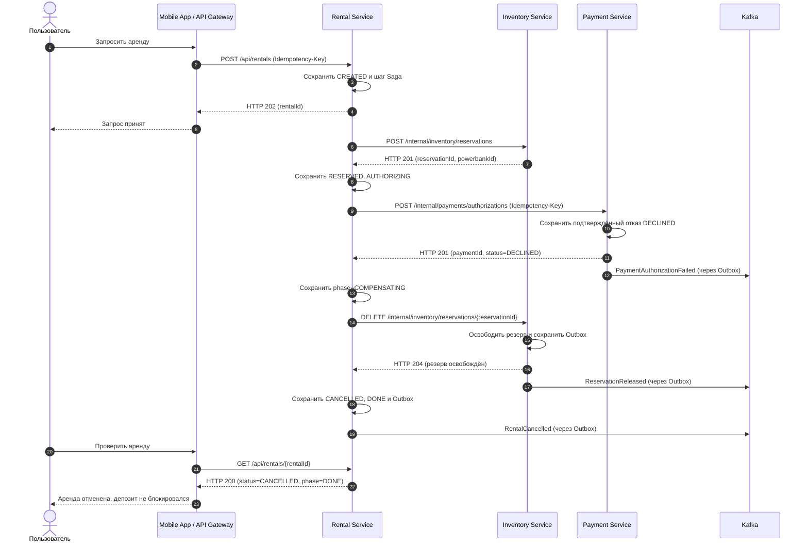
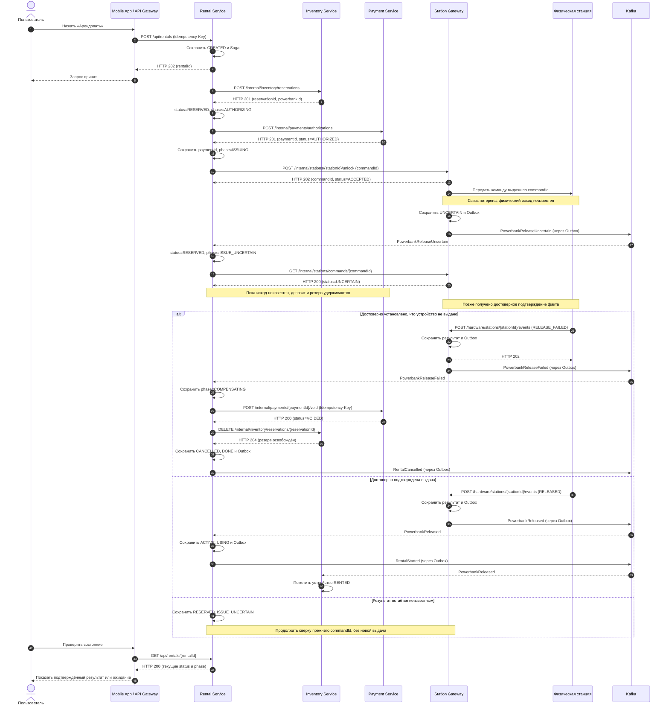

# Главный процесс аренды пауэрбанка

## 1. Цель, границы и участники

Пользователь выбирает станцию и запрашивает аренду. Система проверяет пользователя, резервирует **конкретный** свободный пауэрбанк, авторизует депозит, отправляет станцию команду выдачи и фиксирует **подтверждённую физическую выдачу**. После возврата система фиксирует время окончания, рассчитывает стоимость и выполняет окончательное списание.

Запрос `POST /api/rentals` возвращает **HTTP 202 Accepted** после сохранения аренды `CREATED`; это ещё не означает выдачу устройства. Пользователь узнаёт актуальное состояние через `GET /api/rentals/{rentalId}`. Ответ `202` на команду станции также подтверждает только приём команды, но **не физическую выдачу**.

Главная последовательность `reserve → authorize → unlock → confirmed release` координируется Rental Service с использованием **Saga Orchestration**. Возврат и окончательный расчёт показаны в успешной диаграмме как продолжение жизненного цикла аренды; они не откатывают уже состоявшуюся выдачу.

| Компонент | Ответственность |
|---|---|
| Mobile App и API Gateway | Принимают действия пользователя, направляют HTTP-запросы и показывают состояние аренды. |
| User Service | Проверяет возможность пользователя начать аренду. |
| Rental Service | Владеет арендой, состояниями `status` и `phase`, временем использования, расчётом стоимости и координацией Saga. |
| Inventory Service | Атомарно резервирует конкретный пауэрбанк, освобождает резерв, ведёт состояние оборудования. |
| Payment Service | Авторизует депозит, выполняет `void` и `capture`, хранит платёж и ключи идемпотентности. |
| Payment Provider | Внешняя платёжная система; в учебном стенде может быть имитатором. |
| Station Gateway | Принимает команды выдачи, взаимодействует со станциями, сохраняет подтверждения и публикует события. |
| Физическая станция | Выдаёт и принимает устройство, подтверждает фактические действия и результат команды `commandId`. |
| Kafka | Передаёт события между сервисами. Не является владельцем состояния аренды или оборудования. |
| Notification Service | Асинхронно получает события и формирует уведомления; её недоступность не останавливает аренду. |

**Границы MVP для диаграмм:** показана одна аренда одного устройства и успешный расчёт в пределах ранее авторизованного депозита.

## 2. Состояния, инварианты и идентификаторы

### 2.1. Бизнес-состояние `status` и технический этап `phase`

В соответствии с `openapi.yaml` **`status`** принимает значения: `CREATED`, `RESERVED`, `ACTIVE`, `COMPLETED`, `CANCELLED`. Промежуточные шаги и неопределённые результаты отражает **`phase`**, а не новые значения `status`.

| `status` | Возможный `phase` | Значение |
|---|---|---|
| `CREATED` | `VALIDATING` или `RESERVING` | Аренда создана, идёт проверка пользователя или резервирование. |
| `RESERVED` | `AUTHORIZING` | Пауэрбанк зарезервирован, ожидается подтверждение депозита. |
| `RESERVED` | `ISSUING` | Депозит подтверждён, отправляется или выполняется команда выдачи. |
| `RESERVED` | `ISSUE_UNCERTAIN` | Исход физической выдачи пока неизвестен; ресурсы удерживаются. |
| `CREATED` или `RESERVED` | `COMPENSATING` | Выполняются необходимые компенсации; итоговая отмена ещё не подтверждена. |
| `ACTIVE` | `USING` | Физическая выдача подтверждена, пауэрбанк используется. |
| `ACTIVE` | `CHARGING` | Возврат подтверждён, выполняется окончательный расчёт. |
| `ACTIVE` | `PAYMENT_UNCERTAIN` | Результат окончательного списания неизвестен, требуется сверка. |
| `COMPLETED` | `DONE` | Возврат и окончательное списание подтверждены. |
| `CANCELLED` | `DONE` | Подтверждено отсутствие выдачи и завершены все необходимые компенсации. |

Для состояний `PENDING`, `AUTHORIZED`, `DISPENSING`, `RECONCILING`, `CANCELLING` и `COMPENSATION_PENDING` **не создаются отдельные значения публичного `status`**. Их смысл передаётся комбинацией `status` и `phase`.

Диаграмма выше показывает **только бизнес-статусы**. Например, при потере связи со станцией аренда остаётся `RESERVED`, а `phase` меняется на `ISSUE_UNCERTAIN`. Если необходимо снять резерв или авторизацию, `phase = COMPENSATING` сохраняется до подтверждения этих действий. При подтверждённой выдаче переход в `ACTIVE` разрешён даже после периода неопределённости.

### 2.2. Бизнес-инварианты

1. **Одно устройство — не более одного действующего резерва или аренды.** Inventory Service обеспечивает это атомарной операцией и ограничениями своей БД.
2. **Одна аренда — одна логическая авторизация депозита.** Повторы с прежним `Idempotency-Key` не создают вторую авторизацию. Payment Service сохраняет результат и идентификаторы провайдера.
3. **Одна команда выдачи — не более одной физической выдачи.** `commandId` остаётся постоянным при повторах; такая гарантия требует поддержки со стороны Station Gateway и самой станции.
4. **`ACTIVE` устанавливается только по подтверждённому факту `PowerbankReleased`.** HTTP `202` от шлюза означает лишь приём команды.
5. **Неизвестный результат не равен отказу.** При `ISSUE_UNCERTAIN` запрещено автоматически освобождать резерв или отменять авторизацию по таймауту.
6. **`CANCELLED` устанавливается только после необходимых компенсаций.** Сначала подтверждённый `void` (если депозит был заблокирован) и освобождение резерва, затем финальный статус.
7. **`COMPLETED` устанавливается только после подтверждённого возврата и единственного окончательного списания.** При неизвестном результате списания используется `PAYMENT_UNCERTAIN`.
8. **Критические события должны переживать временный отказ Kafka.** Изменение локального состояния и запись Outbox сохраняются одной транзакцией; потребитель дедуплицирует сообщения через Inbox/бизнес-ограничения.

### 2.3. Идентификаторы

| Идентификатор | Значение |
|---|---|
| `rentalId` | Общий идентификатор аренды, используется для связи шагов Saga и событий. |
| `Idempotency-Key` | Заголовок HTTP-запроса. У каждой логической операции собственный стабильный ключ; при повторе прежней операции он не меняется. |
| `reservationId` | Идентификатор резерва, возвращаемый Inventory Service. |
| `paymentId` | Идентификатор платежа по OpenAPI; используется в `GET`, `capture` и `void`. |
| `commandId` | Идентификатор первоначальной команды физической выдачи. |
| `eventId` | Идентификатор события Kafka для дедупликации обработчиками. |

 При потере ответа на самый первый запрос авторизации, когда `paymentId` ещё неизвестен Rental Service, повторяется **тот же `POST /internal/payments/authorizations` с тем же `Idempotency-Key` и тем же телом**. Payment Service обязан распознать повтор и вернуть прежнюю логическую операцию. Если `paymentId` уже известен, возможен `GET /internal/payments/{paymentId}`. 

Конкретные значения таймаутов и сроков действия резерва здесь не задаются. Истечение времени само по себе не доказывает, что устройство не выдано или деньги не заблокированы.

## 3. Алгоритм Saga и правила компенсации

Rental Service сохраняет каждый завершённый шаг и состояние Saga в Rental DB. После перезапуска он продолжает работу по этим записям, используя прежние идентификаторы запросов.

| Шаг | Действие | Если операция не удалась |
|---|---|---|
| 1 | `POST /internal/inventory/reservations` — создать резерв | При достоверном отказе резерв не создан, отменяем аренду без компенсации. При потере ответа сверяем прежнюю операцию идемпотентным повтором. |
| 2 | `POST /internal/payments/authorizations` — авторизовать депозит | При окончательном `DECLINED` освобождаем резерв. При таймауте не считаем отказ подтверждённым: сверяем исходную операцию. |
| 3 | `POST /internal/stations/{stationId}/unlock` — принять команду выдачи | При подтверждённой невыдаче выполняем `void` и освобождаем резерв. При неизвестном результате — `ISSUE_UNCERTAIN`, без компенсации до сверки. |
| 4 | Подтверждённая выдача через `PowerbankReleased` | Устанавливаем `ACTIVE`; физическую выдачу нельзя «откатить» только изменением БД. |
| 5 | Возврат через `PowerbankReturned` и окончательное `capture` | После подтверждённого возврата завершаем финансовый расчёт вперёд; не снимаем ранее выданное устройство с учёта как будто аренды не было. |

**Порядок компенсации после достоверной невыдачи:** `POST /internal/payments/{paymentId}/void` → после подтверждения `VOIDED` выполнить `DELETE /internal/inventory/reservations/{reservationId}` → после подтверждения `204` установить `CANCELLED`. Если операция компенсации недоступна или возвращает ожидающий статус, сохраняем `phase = COMPENSATING` и повторяем прежнюю операцию. `void` отменяет блокировку, **`refund`** возвращает уже списанные деньги: это разные операции.

## 4. Sequence-диаграмма № 1 — успешная аренда от выдачи до завершения

**Пояснение:** `202` при создании аренды и при запросе выдачи не доказывает физическую выдачу. `PowerbankReleased` от Station Gateway через Kafka подтверждает фактическую выдачу; Rental Service и Inventory Service самостоятельно сохраняют её последствия. Повторная доставка не должна повторно начинать аренду. После возврата `PowerbankReturned` Rental Service рассчитывает стоимость, а окончательное `capture` подтверждается Payment Service. Только затем аренда становится `COMPLETED`. Уведомления не входят в критический путь.

В этой диаграмме показаны **успешные ответы**. При `PENDING`, `VOID_PENDING`, таймаутах, `UNCERTAIN` или окончательных отказах действуют правила сверки и компенсации из следующих разделов. HTTP-событие от физической станции в учебном стенде предполагает доверенный канал и проверку `X-Station-Key` согласно OpenAPI.

## 5. Sequence-диаграмма № 2 — сбой: Inventory создал резерв, но ответ потерялся

**Что сломалось:** Inventory Service успел атомарно сохранить резерв и Outbox, затем соединение оборвалось до получения Rental Service ответа `201`. **Неизвестный результат не равен отклонённому резерву.**

**Восстановление:** Inventory сохраняет резерв ровно один раз в пределах своего бизнес-правила. Rental Service повторяет **ту же логическую операцию** (`rentalId`, `stationId`, `Idempotency-Key` не меняются), получает старый результат и продолжает Saga. **Компенсация не нужна**, потому что резерв существует и аренда продолжается. Если после восстановления выяснится достоверный отказ в резерве, аренда отменяется без денежной компенсации. Ни по таймауту, ни по отсутствию HTTP-ответа резерв не освобождается вслепую.

## 6. Sequence-диаграмма № 3 — сбой: депозит окончательно отклонён

**Что сломалось:** Inventory уже создал резерв, но Payment Service вернул подтверждённый `DECLINED`. Пользователь не получил пауэрбанк. Нужно освободить резерв.

**Компенсация:** выполняется только `Inventory.release` (HTTP `DELETE`, успешный ответ `204`). Платёж окончательно **отклонён**, поэтому **`void` не требуется**: подтверждённой блокировки не было. Если Inventory временно недоступен, Rental Service остаётся в `phase = COMPENSATING`, сохраняет прежний `reservationId` и повторяет отмену после восстановления. `CANCELLED` объявляется только после подтверждения освобождения резерва. Если платёжный запрос вернул таймаут или `PENDING`, это не `DECLINED`: сначала выполняется сверка платежа по прежнему ключу или известному `paymentId`.

## 7. Sequence-диаграмма № 4 — сбой: результат выдачи неизвестен

**Что сломалось:** устройство зарезервировано, депозит авторизован и команда `unlock` принята, но связь со станцией потеряна. Ни выдачу, ни невыдачу пока считать подтверждённой нельзя.

**Компенсация при подтверждённой невыдаче:** `void` блокировки депозита → освобождение резерва → `CANCELLED`. Если `void` вернул `202`/`VOID_PENDING`, Rental Service не переходит к окончательной отмене, а дожидается `VOIDED` (или достоверно сверяет результат). При недоступности Inventory/Payment сохраняет `phase = COMPENSATING` и продолжает те же операции. Если станция подтверждает `RELEASED`, аренда переходит в `ACTIVE`: **депозит не отменяется, резерв не освобождается**. Если станция остаётся недоступной, сохраняется `ISSUE_UNCERTAIN`, необходимы повторная сверка и при необходимости ручной разбор. Статус `FAILED` допустим для компенсации только при достоверном подтверждении **невыдачи** (событие `PowerbankReleaseFailed`), а не при обычной ошибке связи.

## 8. Общие отказы и ответы на защите

| Сбой | Поведение системы | Почему нет потери или дубля |
|---|---|---|
| Rental Service упал между шагами | После восстановления читает сохранённую Saga и продолжает исходный шаг. | Не создаётся новая аренда и не меняются ключи первоначальных операций. |
| Inventory сохранил резерв, но ответ потерялся | Rental повторяет исходный `POST` с тем же `rentalId`, `stationId` и `Idempotency-Key`. | Inventory возвращает тот же резерв; атомарный контроль исключает двойную бронь. |
| Payment Service упал после авторизации, но до ответа | При неизвестном `paymentId` повторить исходный `POST` с прежним ключом; при известном `paymentId` — `GET /internal/payments/{paymentId}`. | Payment и провайдер должны поддерживать идемпотентность логической операции. |
| Station Gateway или станция недоступны | `RESERVED / ISSUE_UNCERTAIN`, сверка `GET /internal/stations/commands/{commandId}` и событий прежней команды. | Не повторяется новая выдача; резерв и депозит удерживаются до достоверного результата. |
| Payment отклонил депозит | Освобождается резерв; после `204` аренда становится `CANCELLED`. | Новая платёжная авторизация не создаётся; двойной резерв отсутствует. |
| Kafka недоступна | Отправитель сохраняет бизнес-факт и Outbox в собственной БД, затем повторяет публикацию. | Временная недоступность брокера не стирает уже сохранённое обязательство публикации. |
| Kafka повторила событие | Получатель использует `eventId`, Inbox и бизнес-ограничения. | Второй бизнес-эффект не применяется, даже если сообщение доставлено повторно. |
| Компенсация не завершилась | `phase = COMPENSATING`, повтор исходной операции после восстановления; не показывать `CANCELLED` заранее. | Уже выполненные шаги не повторяются как новые логические операции. |
| Физическая выдача подтверждена, но окончательная оплата не прошла | После возврата аренда остаётся `ACTIVE / PAYMENT_UNCERTAIN` или в согласованном этапе обработки оплаты до сверки. | Нельзя «отменить» уже состоявшуюся аренду или выполнить новое списание без проверки исходного. |

### Ограничения гарантий

Доставка событий **at least once** допускает повтор. Архитектура добивается однократного бизнес-эффекта с помощью идемпотентности, Outbox/Inbox, проверки статусов и уникальных ограничений. Это **не обещание глобального exactly once** между PostgreSQL, Kafka, платёжным провайдером и физическим оборудованием. Гарантия недвойной физической выдачи требует, чтобы станция или шлюз имели устойчивый журнал `commandId` и могли надёжно подтверждать фактическую выдачу. Если этого нет, необходим ручной разбор неопределённого случая.
