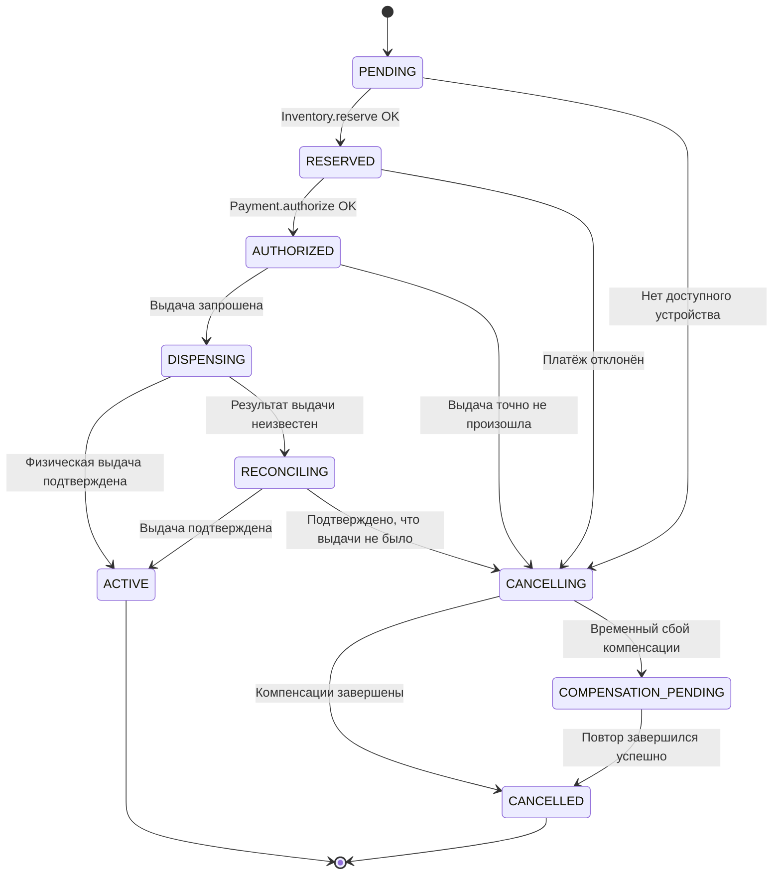
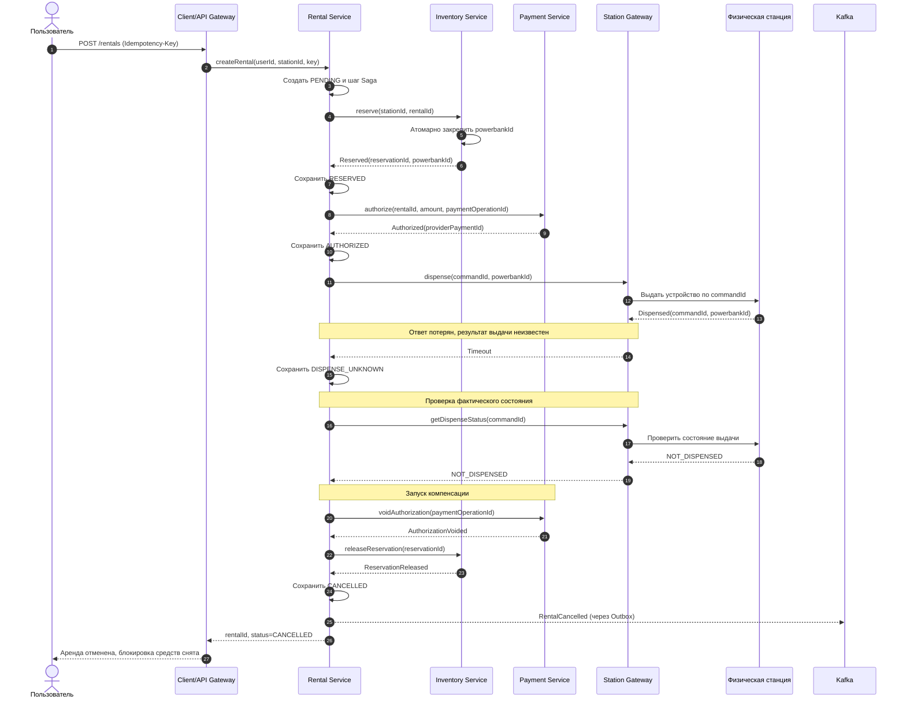
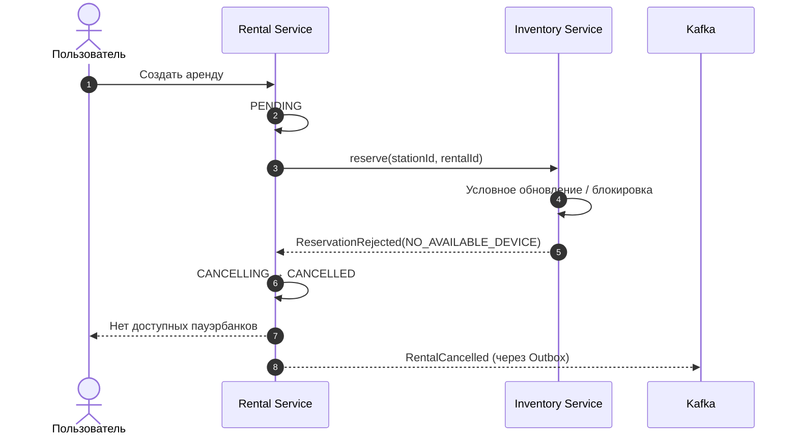
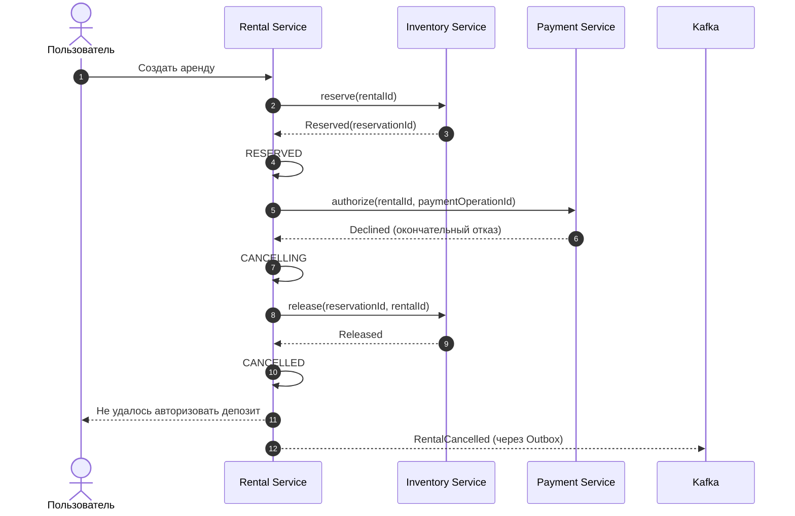
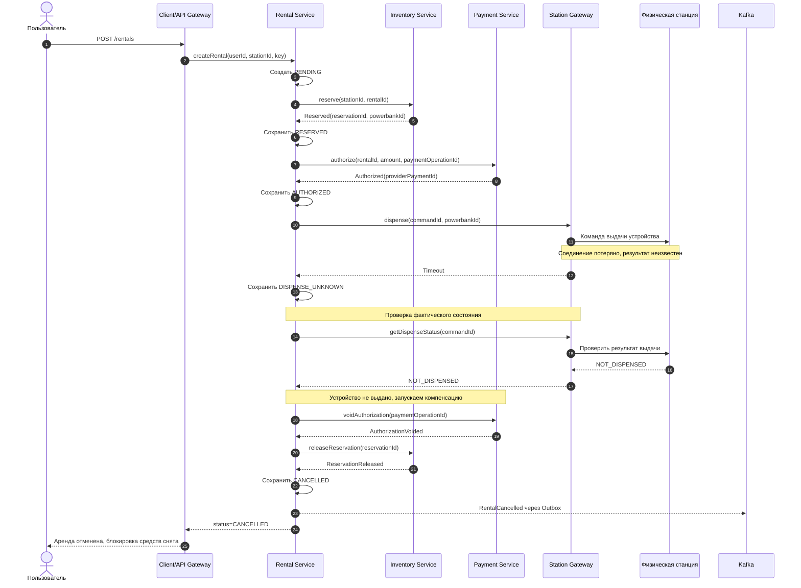

# Главный процесс: запуск аренды пауэрбанка

**Проект:** Powerbank Rental Platform  
**Статус:** архитектурный проект, часть 1 (без реализации)  
**Ответственный:** участник 3 — главный процесс и отказоустойчивость

## 1. Цель и границы процесса

Пользователь выбирает станцию и нажимает «Арендовать». Система должна зарезервировать **конкретный** пауэрбанк, авторизовать депозит (удержать сумму, а не списать её окончательно), отправить команду станции на выдачу и подтвердить физическую выдачу. **Аренда считается начатой только после подтверждённой физической выдачи устройства**, а не после отправки команды станции.

В процессе участвуют:

| Компонент | Ответственность в этом процессе |
|---|---|
| **Client / API Gateway** | Принимает запрос пользователя и возвращает статус процесса. |
| **Rental Service** | Владеет арендой, её статусом и шагами Saga; оркестратор. |
| **Inventory Service** | Атомарно резервирует конкретное устройство и снимает резерв. |
| **Payment Service** | Авторизует депозит и отменяет авторизацию при неуспешной аренде. |
| **Station Gateway** | Доставляет команду физической станции и получает подтверждение фактической выдачи. |
| **Physical Station** | Выдаёт устройство и сообщает результат по `commandId`. |
| **Event Broker (Kafka)** | Доставляет события состояния другим сервисам; не является источником истины. |

Вне границ диаграмм: регистрация пользователя, окончательный расчёт аренды после возврата, уведомления. Эти процессы могут быть описаны отдельно. Общую модель имен сервисов и команд надо синхронизировать с авторами `context-map.md`, `c4.md`, `openapi.yaml`, `asyncapi.yaml`.

## 2. Состояния и инварианты

### Состояния Rental

`COMPENSATION_PENDING` — технический статус, означающий, что пользовательская операция не состоялась, но очистка резерва и/или отмена удержания ещё выполняется. **Нельзя показывать `CANCELLED` до подтверждения требуемых компенсаций.**

### Инварианты

1. **Один пауэрбанк — максимум одна активная бронь или аренда.** Это гарантирует Inventory Service атомарной операцией с блокировкой строки или условным обновлением в собственной БД; проверка только на стороне Rental недостаточна.
2. **Одна аренда — не более одной авторизации депозита.** Payment Service обрабатывает повторные команды с тем же ключом идемпотентности и хранит `providerPaymentId`.
3. **Одна команда на выдачу — один логический результат.** Используется устойчивый `commandId`; при повторе нельзя физически выдать второе устройство.
4. **Аренда `ACTIVE` только после положительного подтверждения фактической выдачи от станции** (`Dispensed`), а не после HTTP `200` от шлюза.
5. **При неизвестном результате выдачи не освобождаем бронь и не отменяем авторизацию вслепую.** Сначала сверяем состояние станции по `commandId` и физический статус ячейки.
6. **Публикация события не может потеряться после записи состояния.** Для изменения состояния и исходящего события применяется Transactional Outbox в той же локальной транзакции.

### Идентификаторы и таймауты

| Идентификатор | Для чего |
|---|---|
| `rentalId` | Основной сквозной идентификатор процесса. |
| `idempotencyKey` | Повтор пользовательского запроса создания аренды возвращает прежнюю операцию. |
| `reservationId` | Резерв конкретного устройства. |
| `paymentOperationId` | Идемпотентная авторизация депозита / её отмена. |
| `commandId` | Идемпотентная физическая команда выдачи. |
| `eventId` | Дедупликация событий в обработчиках. |

Конкретные длительности таймаутов и TTL брони — конфигурация, а не зафиксированные в архитектуре числа. TTL **не должен автоматически возвращать устройство в `AVAILABLE`, пока выдача имеет неизвестный исход**.

## 3. Общий алгоритм: Saga orchestration

Rental Service сохраняет текущий шаг и статус в своей БД. Для каждого следующего действия отправляется команда соответствующему сервису. Если шаг не выполнен, оркестратор запускает обратные действия; каждый шаг и компенсация идемпотентны.

| Шаг | Действие | Компенсация |
|---|---|---|
| 1 | Inventory: зарезервировать устройство | Inventory: снять резерв |
| 2 | Payment: авторизовать депозит | Payment: отменить авторизацию (`void`) |
| 3 | Station: выдать устройство | Если выдачи **точно не было** — отменить авторизацию и бронь; если уже была — нельзя считать аренду несостоявшейся, перейти к `ACTIVE` и разбирать фактическую аренду отдельно |

**Важно:** `void` отменяет неисполненную авторизацию; это не `refund` уже списанного платежа. При иной модели провайдера компенсацию нужно согласовать с его API.

## 4. Sequence-диаграмма № 1 — успешный запуск аренды

Депозит авторизован, но не списан окончательно. После возврата устройства отдельный процесс рассчитает стоимость и произведёт списание/освобождение остатка — не часть этой Saga.

## 5. Sequence-диаграмма № 2 — сбой: устройство уже занято

**Что сломалось:** свободное устройство было занято другим запросом до резервирования либо все устройства станции недоступны. **До оплаты процесс не дошёл.**

**Компенсация:** не требуется: ни резерв, ни платёж не созданы. Повторный запрос с тем же `idempotencyKey` не запускает новую аренду; новая попытка — с новым ключом. **Гарантия от двойной брони находится в Inventory**, а не в диаграмме.

## 6. Sequence-диаграмма № 3 — сбой: авторизация депозита отклонена

**Что сломалось:** резерв получен, но платёжный провайдер однозначно отклонил авторизацию. Требуется снять резерв.

**Компенсация:** `Inventory.release`. Если Inventory временно не отвечает, Rental сохраняет `COMPENSATION_PENDING`, повторяет **ту же** команду освобождения, а не создаёт новую. Для `Payment.authorize` timeout нельзя считать окончательным отказом: сначала проверить статус `paymentOperationId` у Payment Service/провайдера, иначе можно освободить устройство при существующем удержании.

## 7. Sequence-диаграмма № 4 — сбой: результат физической выдачи неизвестен

**Что сломалось:** деньги авторизованы, команда выдачи отправлена, но Station Gateway потерял связь со станцией / ответ не дошёл. Это **не то же самое**, что «станция точно не выдала устройство». Вариант ниже показывает сверку, по результатам которой достоверно установлено: устройство **не выдано**.

**Компенсация:** сначала `Payment.voidAuthorization`, затем `Inventory.release`. Если один шаг недоступен, сохраняем `COMPENSATION_PENDING` и повторяем до подтверждения. Если сверка покажет `DISPENSED`, Rental переключает аренду в `ACTIVE` и **не отменяет депозит**. Если станция остаётся недоступной, результат остаётся `RECONCILING`: нельзя обещать отмену или освобождать резерв по одному таймауту. Случаи физической потери/спорного состояния устройства требуют ручного разбора.

## 8. Общие отказы: что отвечать на защите

| Отказ | Реакция | Что гарантируем |
|---|---|---|
| Rental Service упал между шагами | После восстановления читает сохранённые шаги Saga и продолжает; команды повторяются с прежними ключами. | Не создаём вторую аренду / платёж при восстановлении. |
| Inventory упал до ответа на `reserve` | Rental сверяет результат по `rentalId`/ключу операции, а не предполагает отказ. | Не резервируем дважды; после восстановления определяем исход. |
| Payment упал после авторизации, до ответа | Запрос статуса по `paymentOperationId`, повтор с тем же ключом. | Не авторизуем депозит второй раз. |
| Station Gateway или станция недоступны | `RECONCILING`, опрос результата `commandId`; компенсация только при подтверждённой невыдаче. | Не выдаём потенциально занятый пауэрбанк другому пользователю. |
| Kafka недоступна | Бизнес-статус и событие записываются в локальную БД/Outbox; публикация будет повторена. | Событие не теряется из-за временного простоя брокера. |
| Kafka доставила событие повторно | Consumer проверяет `eventId` в Inbox в одной транзакции с бизнес-эффектом. | Не обрабатываем одно событие дважды в рамках локального эффекта. |
| Компенсация не прошла | `COMPENSATION_PENDING`, повтор идемпотентной команды + мониторинг. | Не объявляем успешную отмену раньше подтверждения. |

### Ограничения гарантий

«Exactly once» между независимыми сервисами и физическим оборудованием **не предполагается**. Архитектура использует доставку *at least once*, идемпотентные операции и сверку внешних результатов. Физическую недвойную выдачу должно поддерживать само оборудование или шлюз (журнал обработанных `commandId` и защита от повторного открытия); без этого обещать строгую гарантию нельзя.

